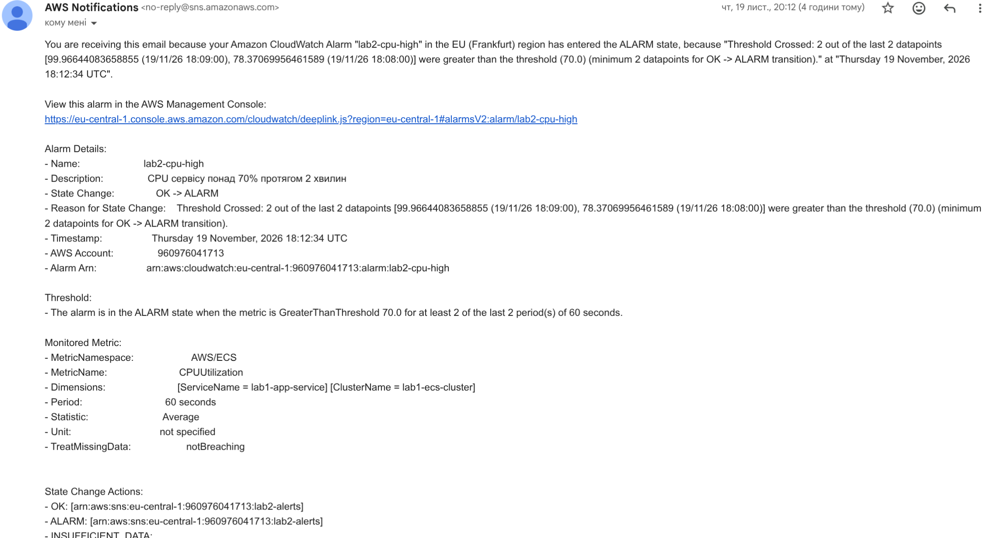
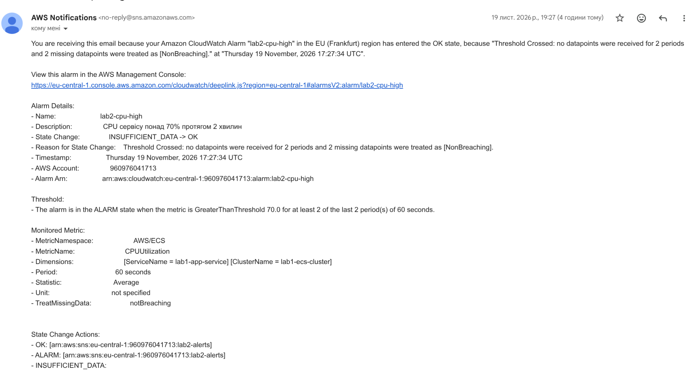

# Сповіщення

## Умова

**Середнє завантаження CPU сервісу понад 70% протягом 2 хвилин.**

Alarm `lab2-cpu-high`:

| Параметр | Значення |
|---|---|
| Метрика | `AWS/ECS` `CPUUtilization`, статистика Average, сервіс `lab1-app-service` |
| Період | 60 с |
| Умова спрацювання | 2 з 2 останніх хвилинних точок вище порогу |
| Поріг | 70 |
| Дія на ALARM | лист через SNS-топік |
| Дія на OK | лист через той самий топік при поверненні до норми |

Канал доставки — SNS-топік з підпискою за email. Підписку треба підтвердити в листі від AWS, інакше сповіщення не надходитимуть.

## Обґрунтування

- Ціль автомасштабування — 60%. Якщо CPU тримається вище 70% дві хвилини, масштабування не справляється: нові копії ще не стартували або досягнуто максимуму. Саме тоді людині варто подивитися на сервіс.
- 70% вище за 60%, тому звичайне додавання копії лист не викликає.
- Дві точки поспіль захищають від короткого стрибка CPU (наприклад, при старті контейнера). Без цього алерт перемикався б ALARM ↔ OK щохвилини.
- Лист OK повідомляє, що проблема минула, і не потрібно перевіряти вручну.

## Листи під час прогону

Усі часи в UTC, 19.11.2026.

| Подія | Час |
|---|---|
| Початок навантаження (T0) | ~18:40:00 |
| Початок сталого навантаження | ~18:43:00 |
| Лист ALARM | ~18:46:30 |
| Лист OK | ~18:54:00 |

Від початку сталого навантаження до першого листа (ALARM) минуло **~3 хв 30 с**.

## Із чого складається затримка

1. До 1 хв: ECS агрегує CPU за хвилину і публікує точку.
2. 2 хв: потрібні дві точки поспіль вище 70%.
3. До ~1 хв: CloudWatch оцінює alarm періодично.
4. Секунди: SNS надсилає лист, поштовий сервер його доставляє.

Разом близько 3–4 хв від початку проблеми до листа.

## Чи прийнятний такий час реакції

Для навчального сервісу — так. Для реального сервісу сповіщення за CPU — це причина, а не симптом. Користувач відчуває латентність і помилки, тому корисніше сповіщення на p95 латентності або частку 5xx. Лист — повільний канал, для чергового інженера краще Slack або PagerDuty.